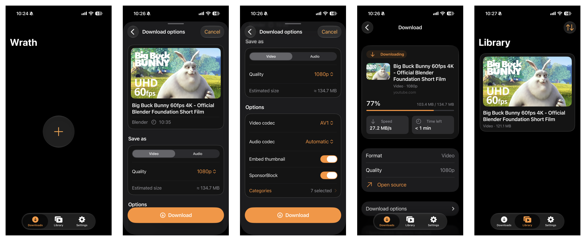

# Wrath

Wrath is a simple video and audio downloader for iOS 27, with a native Liquid Glass interface. Paste a link, choose your options, and save the file to your device.

Download the unsigned IPA from [the latest release](https://github.com/DjangoCustard225/Wrath/releases/latest) and sign it with your preferred sideloading tool.

## Screenshots

<picture>
  <source media="(max-width: 600px)" srcset="docs/screenshots/readme-mobile.png">
  
</picture>

## About

Wrath doesn’t host or provide any content. It’s simply a native wrapper around yt-dlp and FFmpeg; downloads come from the links you provide.

Credit goes to the developers and contributors behind:

- [yt-dlp](https://github.com/yt-dlp/yt-dlp) for media extraction and website support.
- [FFmpeg](https://ffmpeg.org/) for media processing.

Thank you to everyone who maintains these projects and makes apps like Wrath possible.

To build it yourself, use macOS with Xcode 27 and Python 3, then run `python3 Scripts/Build.py`.

Wrath’s source is [MIT licensed](LICENSE). Bundled components retain their [own licenses](Wrath/Resources/Licenses).
